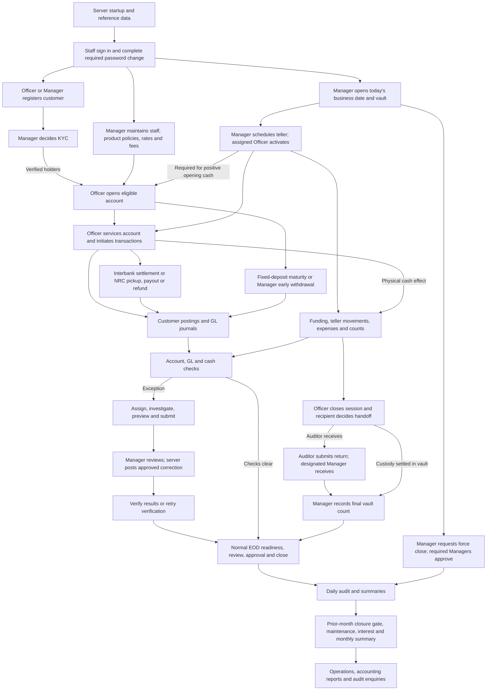

# Project workflows and operations

## Whole-system flow

Two activities can proceed independently at the start of a day. The Manager can open the vault and assign tellers while staff register customers and review identity documents. Those activities meet when an Officer accepts customer cash. Later, customer balances and physical cash follow separate paths into reconciliation. Both must be accounted for at normal close.

**Follow one cash deposit through the system.** The Officer selects an eligible customer account and enters the amount during an active teller session. Posting increases the customer's balance and the teller's expected cash, and creates the corresponding journal. At handover the Officer enters the amount physically counted. A difference remains attributable to that session. The Manager can trace it from the reconciliation finding to the count, movements and journal, assign investigation, and see the verified result before closing. The daily summary uses the posting date. Monthly reporting uses the closed period.

**Follow a pending transfer across dates.** Creating an interbank transfer debits the source and creates a pending settlement record. Its pending status alone permits the original day to close. Later completion or failure uses the settlement workflow, preserving the original transaction and any linked refund. An earlier date can also stay open for settlement and investigation while today's active date accepts new postings.

**Startup and recovery.** Server initialization supplies role grants, the chart of accounts, products and branches used by staff workflows. Personal preference seeding fills missing rows. Monthly summary backfill uses existing financial history. The historical opening-deposit repair runs separately from normal server startup. [Server startup](../Program.cs)

## Actors and responsibilities

| Actor | Operations available with seeded permissions |
| --- | --- |
| Manager | Manage staff and customer profiles, decide KYC, configure products and rates, start the business date, schedule officers, approve vault funding, receive cash, review expenses and corrections, run and approve EOD, manage job failures, and quote or execute early withdrawal. Managers can settle pending interbank transfers. |
| Officer | Register and edit customers, open and maintain accounts, activate their own teller assignment, process customer transactions, request and receive funding, transfer and count cash, hand over custody, submit expenses, and investigate assigned discrepancies. |
| Auditor | Inspect authorized records, journals and audit history, run checks, investigate assigned cases, receive teller cash as a designated recipient and submit that custody to a manager. Auditor acceptance of cash is a physical custody decision. Financial correction and EOD approvals belong to authorized managers. |
| Signed-in user | Change own password, retrieve own permissions, read or dismiss own notifications, and access preferences enabled for their role. |
| Scheduler / server | Run due jobs, expire unused assignments, calculate interest and fees, settle mature deposits, persist notifications and summaries, and retain audit evidence. |

Service checks further restrict who may act on a particular record. For example, a second manager with vault authority cannot accept a return addressed to the first manager. [Role grants](../Data/Seeders/RolesAndPermissionsSeeder.cs) · [Permission enforcement](../Middlewares/MiddlewareAttribute.cs)

## Open a business date

| Step | Manager action | What must be true to continue |
| --- | --- | --- |
| 1. Enter opening cash | Open **Business Date Opening** and enter the physical starting vault cash in MMK. Zero is valid. Use at most two decimal places. | The manager holds EOD approval permission and today's Myanmar date is eligible to start. A previous date may still be open. The manager's enabled Default Vault Opening preference can prefill an empty field. |
| 2. Optionally schedule tellers | For each row select an active Officer, enter same-day Myanmar start and end times and positive starting cash to at most two decimal places. Leave the schedule empty to assign officers later. | End must follow start. Total allocations must fit available vault cash. Overlap with an already Open or ClosePending assignment for that officer blocks scheduling. Unopened assignments may overlap. |
| 3. Review and start | Confirm the date, opening cash and assignments. The desktop sends the expected date and retry key with the request. | A stale date or conflicting retry requires refreshing the opening screen. An invalid row or insufficient cash prevents the entire opening. |
| 4. Accept assignments | The server creates today's open date, its vault and the submitted teller schedules in one transaction. It reserves each allocation and deactivates any previously active date. Each assigned Officer accepts their own schedule. | Ordinary posting uses today's active date. An officer's teller writes additionally require an activated session. Older open dates remain selectable for settlement, reconciliation and EOD. |

[Opening form](../../bams.desktop/ViewModels/Pages/Accounting/BusinessDateOpeningViewModel.cs) · [Date and vault creation](../Services/BusinessDateService.cs) · [Schedule validation](../Services/CashScheduleValidation.cs)

## When a feature is unavailable

| What staff see or cannot complete | Who can clear it and how | What becomes available |
| --- | --- | --- |
| Forced password change after provisioning or reset | The user changes their own password. An inactive account also requires a Manager to address its status. | Permission-protected business actions for that user. |
| No current posting date | Manager enters opening cash and starts today. | New teller assignments, activation and ordinary postings. |
| Officer is scheduled but has no activated session | Assigned Officer accepts during the time window. Finish any Open or ClosePending session first. If the unopened assignment expired, Manager creates another eligible assignment. | Officer writes under transactions, cash operations and handoffs that require a teller session. Reads and customer/account administration have separate gates. A positive account-opening deposit still needs teller cash custody. |
| Account opening unavailable for a holder or product | Manager reviews KYC. Officer corrects holder identities, eligibility, prerequisite product, ownership, referrers, required files or opening balance, as indicated. | The server can create the account when all selected product requirements pass. |
| Transaction rejected for a frozen, suspended or closed account, balance or product limit | Authorized Officer can reactivate an eligible account, use an eligible product or correct the amount. A closed account is terminal. Fixed-deposit principal uses the payout workflow. | Eligible debits and credits. Activating a teller alone cannot clear an account restriction. |
| Vault cash is already reserved | Manager or assigned Officer completes or rejects outstanding funding as applicable, or Manager cancels an unopened assignment. Reduce new allocations to the available amount. | Scheduling or approving further funding within the available vault balance. |
| Session shows ClosePending | Designated recipient accepts the handoff or declines it. Acceptance closes the source. Decline reopens it so the Officer can count again. | Cash activity resumes only on the reopened session. A declined historical handoff requires a fresh count. |
| Auditor holds cash or has submitted a pending return | Auditor selects held handoffs for one date. Designated Manager accepts them into that date's open vault. Decline releases the selection back to the Auditor. | Outstanding custody clears only on receipt. Final vault count and normal close can proceed once other blockers clear. |
| Investigator cannot submit, or Manager cannot approve a stale preview | Assign an eligible investigator, select the correct source and counterpart, supply findings and evidence, refresh the preview and resubmit. A second eligible Manager reviews when independence is required. | Approval of the specific evidenced correction. |
| Correction posted but verification is pending or failed | Assignee or correction approver opens Verification, inspects the saved reason, addresses the outstanding evidence or balance difference and retries verification. | Passing verification removes the task and clears that proposal's normal-close blocker. Retrying does not post money again. |
| Monthly close failed because the prior period is open | Manager completes EOD for the identified date, then requests retry of the failed occurrence. | Maintenance, interest posting and monthly summary generation for that period. |
| Accounting Excel export reports unavailable | The desktop has an export dialog, but the server download route has no implementation. | No user, date, permission or approval action enables the export in this version. |

Session activation, cash counts and selected funding/handoff decisions have explicit exemptions from the general officer write gate. They still check the assignment, recipient, source date, version and state applicable to the action. [Cash operations](../Controllers/CashOperationsController.cs) · [Handoffs](../Controllers/CashHandoffsController.cs)

## Daily branch workflow

1. **Open the date and fund tellers.** A manager enters the vault opening count and schedules officers. An officer accepts an assignment within its activation window and receives the reserved starting cash. Later funding requests pass through approval and receipt.
2. **Serve customers.** Staff complete customer and KYC work, open eligible accounts, and post teller transactions against the active date. Pending transfers have their own settlement workflows and may outlast the day.
3. **Record expenses.** The requester chooses their open teller session or, for a manager, the open vault on the active date. Submission records the payee, purpose, amount and receipt evidence as pending. The requester and managers can inspect the receipt. A manager reviews with a required note. Self-review requires the requester to be the sole active manager. Rejection records the decision. Approval posts the expense against available cash and refreshes provisional summaries. Approval can follow closure of the original session. [Bank expense service](../Services/BankExpenseService.cs)
4. **Count and hand over cash.** The officer records the physical count and selects an eligible recipient where cash remains. A declined handoff returns the session to the officer. Accepted auditor custody must subsequently reach the vault through a manager return for normal close.
5. **Reconcile and close.** Run the unified check, assign exceptions, review proposed corrections and verify posted effects. Record the final vault count, prepare and review the EOD run, approve and close under lock. An authorized force close follows its own approval path and retains the outstanding blockers in the audit.

## Staff access

**Manager** searches staff, selects an assignable role, creates or edits a user, resets a password or soft-deletes the user. The last active Manager must remain available. **Each user** completes a forced change using their current password and a new compliant password. **Manager** can enable Default Vault Opening in personal preferences and enter a positive amount to two decimals. Saving checks the preference update key. Reload a stale preference before saving again. This value prefills the opening form and still requires confirmation when the date opens.

Staff access starts with sign-in. Five failed passwords trigger a five-minute lock. Attempts during the lock preserve its expiry. Successful sign-in resets the failure count, records presence and signals when first login or an administrative reset requires a password change. The client can fetch permissions, refresh the access token and send heartbeats during the session, then record logout. Staff administration includes assignable-role lookup, user creation, profile and status updates, password reset and soft deletion. [Authentication service](../Services/AuthenticationService.cs) · [Role permissions](RolePermissions.md)

## Customer registration and KYC

**Actors:** Manager and Officer register or edit profiles. Manager decides KYC. Auditor has customer enquiry access according to the endpoint permission. When editing a document, select one that belongs to the customer. A new document needs a type. Approval stamps the customer's documents with verification attribution. Rejection leaves account opening blocked.

- Registration requires a name and a valid birth date. The minimum age is 18. Citizens supply an NRC number and foreigners supply a passport number. Supplied email addresses must pass format validation. The NRC directory provides state options and townships for the selected state.
- A new profile starts with pending KYC. The review action accepts Verified or Rejected. Customer detail and document download allow staff with access to inspect the evidence.

## Customer-to-account opening flow

**Actor:** Officer. For a joint account select two distinct verified customers, designate one primary holder, enter positive percentages totaling 100%, and supply a shared signing rule. For an individual account the holder owns 100%. Each required referrer must already own an account. For a positive opening deposit activate the teller session before submitting. A zero opening deposit can proceed without a teller session if the product permits zero.

1. Register the customer and attach identity documents. A manager reviews KYC. Look up each verified holder by NRC or passport and load the opening options for that holder combination.
2. Choose an eligible product and individual or joint ownership. Supply ownership, signing instructions, referrers, opening balance and any fixed-deposit settings required by the product.
3. Review the required documents. For each type the desktop shows the reusable holder document or asks for an upload. Changing holders clears earlier selections. Changing product reloads its requirements.
4. Submit the account with the selected source document IDs or files. The server rechecks eligibility and document availability. If a reusable source became unavailable, the desktop refreshes options and returns to the document step with valid local uploads retained.
5. Successful creation records the account, holders and documents together with any fixed-deposit contract and opening posting. Subsequent account enquiry exposes the statement, status history and interest accruals. [Desktop opening workflow](../../bams.desktop/AccountOpeningWorkflow.md)

## Product, rate and fee administration

**Actor:** Manager. Use Configuration to list, create or edit product policies, fee rules and interest rates. Other Banks is a directory used by interbank transfers and other-bank NRC delivery. Branches supply the lookup for in-branch pickup. Officers consume the available account types and interest rules when opening accounts.

| Staff workflow | Rules checked on create and update | Effect on operations |
| --- | --- | --- |
| Bank policy | A product needs a unique trimmed code and a status. Opening and maintained minima, transaction limits and required referrer counts cannot be negative. The maintained minimum cannot exceed the opening minimum. | The account type supplies opening requirements, product capabilities and transaction limits. |
| Interest rates | A rule identifies an existing product and effective period. Annual and early-withdrawal rates are nonnegative. The lower balance bound cannot exceed the upper bound. Active rules for the same product and term cannot overlap in both balance band and effective dates. Shared endpoints count as overlap. | Opening options, savings accrual and fixed-deposit renewal use the applicable rules described in their respective workflows. |
| Fee rates | A rule needs an existing product, recognized fee type and at least one of fixed amount or percentage. Amounts, bounds and tax are nonnegative. The minimum cannot exceed the maximum. Active rules for the same product and fee type cannot overlap in effective dates. | Transfer pricing uses the effective transfer rule. Scheduled maintenance and dormant penalties require applicable fixed-amount rules. |

For both rate catalogs the end date may be open-ended. A supplied end date must be on or after the start date. [Bank policy validation](../Services/BankPolicyService.cs) · [Interest rate validation](../Services/InterestRateService.cs) · [Fee rule validation](../Services/FeeRateService.cs)

## Teller transactions and settlement

**Actors:** Officer initiates teller transactions and handles NRC payout, cancellation and code reissue. Manager or Officer may complete or fail a pending interbank transaction. Officer and Auditor can inspect transaction history. For branch pickup, expiry requires a valid reissued code. Reaching the failed-attempt limit blocks further pickup and reissue, leaving cancellation and refund.

| Operation | From request to settlement |
| --- | --- |
| Cash deposit or withdrawal | Identify the customer account and amount. Validate the product, account status and posting session. A deposit credits the customer and increases teller cash. A withdrawal debits the customer and reduces teller cash. Both produce account entries, journal entries and a linked cash movement. |
| Internal transfer | Select different source and destination accounts. The server checks the debit and receiving product, determines the fee, then posts the debit and credit together. |
| Interbank transfer | Select the other bank and enter beneficiary details. Creation debits the source and leaves the transfer and gateway pending. Completion records gateway success and any gateway/settlement references. Failure records the failed gateway decision and links a refund of principal and fee. |
| NRC transfer with branch pickup | Create the transfer for the receiver and selected branch. At pickup the server checks delivery type, failed attempts, expiry, receiver identity and code before completing payout. Failed identity or code checks record an attempt. Staff can reissue an eligible pending code or cancel and refund an eligible pending transfer. |
| NRC transfer paid by another bank | Select other-bank delivery when creating the transfer. Record the other bank's payout against the pending transfer. Completion debits NRC Transfers Payable, credits Due From Other Banks and audits the payout reference. |

Staff can find transfers through transaction search and the pending NRC pickup list. Transaction detail ties the customer postings, journal, transfer details and audit trail to the transaction. Account statements show effective corrected balances where present. [Transaction enquiries](../Services/TransactionQueryService.cs)

## Account servicing and fixed deposits

| Actor and action | Inputs and decision | Result or recovery |
| --- | --- | --- |
| Officer maintains an account | Look up the account, inspect its current status and version, select freeze, suspend or reactivate where available, and supply the reason. Edit joint holders by submitting the complete editable state of the existing pair. | History records the transition. Reload a stale version. Holder edits cannot replace customers or proceed after closure. Eligible teller activity reactivates a dormant account. |
| Officer opens or updates a fixed deposit | At opening select a term/rate rule, renewal instruction and calculation source. Select an eligible active individual payout account of the primary holder or use server selection. Later edits cover payout account and renewal instruction. | The contract drives scheduled interest and maturity. A fixed-deposit account does not accept ordinary teller deposits, withdrawals or transfers. |
| Manager quotes and executes early withdrawal | Select an active deposit before maturity and inspect the quote, including earned interest, forfeiture and net payout. Submit the early withdrawal against the contract. | The server credits eligible interest, pays the net to the payout account and closes the deposit and account. |
| Scheduler settles maturity | Select due deposits on an open business date with usable deposit and payout accounts. Accrue final interest and apply the renewal instruction. | No renewal pays the full balance and closes the account. Principal-only renewal pays interest and starts a successor. Principal-and-interest renewal rolls the full balance forward. An unusable payout account defers settlement until eligible. |

## Cash funding, counts and custody

| Operation and actor | Inputs and prerequisites | Next operation |
| --- | --- | --- |
| Manager creates or cancels schedules | Add officer, start/end time and starting cash against today's open vault. Cancel an unopened assignment to release its reservation. | Officer activates the assignment during its window. Acceptance receives its initial funding once. |
| Officer requests more cash | Select own open teller session and enter a required note. Requested amount is optional and must be positive if entered. | Manager enters the approved amount and reviews available vault cash. Approval reserves it. Officer confirms receipt to post the vault issue and teller receipt. Rejection releases any reservation. |
| Officer transfers teller cash | Choose an eligible destination session and amount within available cash. | Paired outgoing and incoming movements update both positions and feed count reconciliation. |
| Officer requests a cash adjustment | Identify the correction transaction, enter the signed cash effect and submit for review. | Independent authorized approval checks the posted Cash on Hand journal effect. Rejection records the reason. A physical count alone cannot authorize an adjustment. |
| Officer counts or closes | Count the physical amount, optionally add notes and select an eligible recipient for positive cash on closure. | Zero cash can close immediately. For positive cash the recipient decides a pending handoff. The sender or authorized reviewer can reassign a still-pending handoff. Officer-to-officer acceptance needs an eligible same-date destination. Historical-date recipients are restricted to Managers or Auditors. |
| Manager or Auditor receives a teller handoff | Open Session Handoff Requests as the designated recipient. | Manager acceptance credits the original date's vault. Auditor acceptance records custody and closes the teller session. The cash stays on the original source position pending manager receipt. |
| Auditor returns held cash | In Cash Transfer select one or more whole accepted handoffs from the same open date and choose the receiving Manager. | The designated Manager uses Manager Cash Receipts to accept or decline with a reason for decline. Acceptance posts one return pair per handoff. An unavailable vault or insufficient source cash prevents the entire batch from posting. |

Session detail connects the assigned officer, movements, proposals, counts, linked customer transactions and handoff history. Cash received and cash expected can differ after a handoff. Investigate the residual on the original session.

## Cash investigation, approval and verification

1. **Manager or Auditor with check access** runs reconciliation for the date or range. Examine cash-balance and missing-movement findings alongside the account/GL results. Assign an eligible investigator.
2. **Assigned investigator** records findings and evidence and selects the appropriate operation. Recount a count-entry error. Record an unrecorded deposit, withdrawal or expense. Link a missing movement to its posted transaction. Select the retained movement for a duplicate, a corrected total for an amount error, or the actual destination for a wrong position. For a transfer mismatch select both ends. For a handoff mismatch also select the accepted handoff. Use cash over/short for an unexplained difference of the detected amount.
3. **Investigator** previews expected and counted cash for each position and the proposed financial entries. **Manager** reviews the evidence and approves or rejects the exact preview. Movement repairs affect the relevant positions. Financial corrections also post a balanced journal.
4. **Server** verifies after the posting commits. A missing non-vault count or remaining mismatch can fail verification. A vault awaiting its first physical count can pass proposal verification and still requires its final EOD count. The Verification queue supports retries. A stale or changed source needs fresh evidence and review. [Detailed case inputs and effects](BusinessRules.md#cash-discrepancy-decisions)

## End-of-day decisions

| Stage | Actor and input | Gate and outcome |
| --- | --- | --- |
| Select date and run checks | Manager or Auditor with check access selects an open date and runs the checks. | Staff may settle an older open date while a newer one serves customers. Review failing stages, cash and account/GL exceptions, pending approvals and failed transactions. A pending customer transfer alone does not block closing. |
| Final physical vault count | Manager enters actual vault cash on the selected date. | Settle teller sessions, handoffs, reserved funding and pending expenses. Return all auditor-held cash. Recording the final count closes the vault and runs reconciliation. A mismatch needs investigation. |
| Review and approve | An eligible Manager independently rechecks a prepared run. The sole eligible manager exception allows the same person where applicable. | Desktop approval requires ReadyForApproval and the signed-in reviewing Manager. Resolve outstanding exception, proposal and verification blockers or use the authorized decision applicable to the case. |
| Normal close | Manager closes the approved run. | The server rechecks readiness under lock, records the audit and daily summaries, closes this date and cancels a competing pending force-close request. Review the returned stage or record IDs if close is rejected. |
| Force Pass one exception | Authorized Manager records a reason against the observed source evidence. | The exact unchanged source is excluded. A change can reopen investigation. This decision applies to that finding and does not close the business date. |
| Force close the date | Manager supplies a reason (desktop accepts 5–1,000 trimmed characters). Every required Manager recorded for the request must approve. The requester counts as one approval. | Final approval closes the date, records observed blockers and supersedes unfinished normal runs. Outstanding cases retain their states. Later financial corrections require a strictly later active open date. Auditor custody still outstanding at force close cannot be returned through the closed-date return workflow. |

[EOD desktop action conditions](../../bams.desktop/ViewModels/Pages/Accounting/EndOfDayViewModel.cs) · [Server closing workflow](../Services/EndOfDayWorkflowService.cs)

## Account and general-ledger investigation

**Actors:** Manager or another authorized assigner selects an eligible investigator. Only the assigned Manager, Officer or Auditor prepares that task. A correction approver reviews it. A Manager may approve their own submission only when they are the sole active Manager and have approval permission.

The investigator opens the assigned exception, selects source entries and a diagnosis, previews the customer and GL effects, then saves a draft or submits the proposal. Manager review acts on the submitted plan. Verification checks the resulting entries and balances. The planner supports these differences. [Correction planner](../Services/CorrectionPlanningService.cs)

| Diagnosis | What the plan corrects |
| --- | --- |
| Missing GL posting / incomplete journal | Reconstruct a wholly missing journal from customer postings and an evidenced offset, or supply missing components of an existing journal. Verify the combined journal. |
| Missing account posting | Compare customer-linked deposit liability entries with recorded customer postings and append the outstanding customer difference. |
| Incorrect amount / wrong direction | For an amount error, apply the difference on each selected side. For a direction error, offset the original effect and apply the correct direction. |
| Wrong customer account / wrong GL account | Reverse the selected attribution and apply it to the correct account. A GL reclassification alone has no customer balance effect. |
| Duplicate posting | Offset the selected duplicate components, or the whole duplicate transaction when no component is selected. |
| Posting date mismatch | Offset the selected customer entry on its recorded date and reapply it on the target date. When correcting the journal, move its lines together. |
| Opening balance | Apply the amount correction to the account's first posting. The planner checks posting date and entry ID to establish which posting came first. |
| Balance snapshot | Rebuild derived balances from verified movements and retain original snapshots and calculation evidence. |

- The unified reconciliation check evaluates account/GL consistency and cash custody discrepancies, including physical cash versus the server-calculated expected cash position. Each run retains its result snapshot and exception history.

## Scheduled operations

**Actors:** Scheduler executes the occurrence. Manager inspects exhausted failures and requests an eligible retry. Startup backfill builds missing historical monthly GL summaries in period order and stops at an unclosed month. The account-opening cash repair is a separate operator command with preview by default. Applying a repair requires a manager actor and an unambiguous original teller session. Existing links are skipped. [Repair command](RepairCommands.md)

- The scheduler registers reconciliation at the configured positive interval (default 1,440 minutes), unactivated-session expiry every 15 minutes, fixed-deposit maturity hourly, and monthly accounting close at Myanmar midnight on the second day of the month.
- Monthly close uses the scheduled occurrence to select the previous month. It checks date closure, runs maintenance, runs interest, then publishes the monthly GL summary. If closure blocks the run, staff close the identified date through EOD before requesting a retry of that occurrence. [Monthly close service](../Services/MonthlyAccountingCloseService.cs)

| Scheduled result | Where staff see it | Follow-up |
| --- | --- | --- |
| Monthly savings interest accrual | Operations → Interest, account accrual detail and accounting entries | The account must qualify for the period and a balance tier. Quarter-end settlement gathers eligible outstanding accruals. Fixed deposits accrue against their term and settle through their contract. |
| Maintenance fees and dormant penalties | Operations → Fees and the account statement after collection | Maintenance accrues monthly for quarter-end collection. Dormant penalties are collected monthly. Insufficient funds leave the accrual outstanding for a later eligible run. |
| Fixed-deposit maturity | Operations → Fixed Deposit Maturity, the deposit detail and payout account | Trace the payout or successor contract. If the payout account was unusable, restore eligibility for a later run. |
| Open-date summary revisions | Reconciliation history and accounting summaries | Authorized staff can refresh provisional summaries from a selected open date forward. Closed-date final summaries retain their posting history. |

Legacy correction-request and review routes direct users to resubmit through the current investigation and proposal workflow. Historical records remain available for audit. [Reconciliation contracts](ApiContracts.md#account-reconciliation-correction-workflow)

## Enquiries, reporting and notifications

**Actors:** Manager uses the per-customer Operations pages and job failure list. Manager and Auditor can use accounting views. Auditor inspects audit records. Each notification recipient controls their own unread items.

- **Customer operations.** The Operations pages list interest accruals, fees and fixed-deposit maturities. Staff can search and open an item to inspect its account, primary holder and calculation or maturity details. These enquiries read the existing operation. Financial changes use the corresponding posting or deposit workflow. [Operations query service](../Services/OperationQueryService.cs)
- **Accounting reports.** Start with the GL directory, a daily or monthly summary, or Accounting Entries. Drill into an account or month to see the underlying journals. Entry filters choose matching transactions and the results include every line of those transactions. The desktop shows debit and credit totals, customer ownership on customer lines, and bank-internal lines. The current-month view defaults to the Myanmar calendar month. The Excel export control currently returns `AccountingExportUnavailable` because the server export endpoint is missing. [Accounting workflows](../../bams.desktop/AccountingWorkflows.md)
- **Audit.** Authorized staff can search audit records, open a record and run a date-specific EOD audit. The persisted reconciliation and closure evidence supports later review. Debug builds also expose permission-gated audit fixtures for balanced, unbalanced, missing-entry and pending scenarios. These fixture actions write data. [Audit controller](../Controllers/AuditController.cs) · [Debug fixtures](../Controllers/AuditTestDataController.cs)
- **Notifications.** A workflow addresses individual users, role members or permission holders. The service selects distinct active recipients and excludes the initiating user. The bell shows the recipient's unread count and newest unread items. A user may mark one or all of their own items read. Workflows can dismiss a related group of outstanding alerts when its task changes state. Reading an alert leaves the underlying decision to the relevant workflow. [Notification service](../Services/Notifications/NotificationService.cs)
