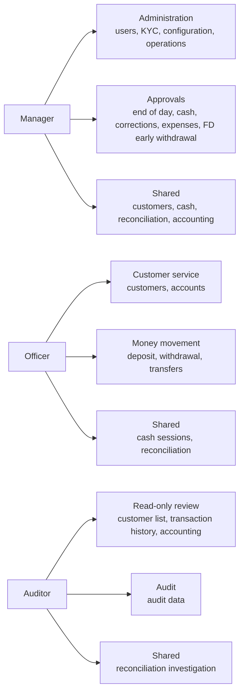

# Role permissions

Describes what each system role (Manager, Officer, Auditor) may do. Authorization is enforced server-side by `[RequirePermission(...)]` on controllers. A permission code listed with several values means any one of them grants access.

Sources of truth:

- Role and permission codes: `Constants/SecurityConstants.cs`
- Role-to-permission grants: `Data/Seeders/RolesAndPermissionsSeeder.cs`
- Endpoint enforcement: `[RequirePermission]` attributes in `Controllers/`

Legend: ✅ allowed &nbsp;&nbsp; ➖ not allowed

---

## 1. Roles

| Role | Purpose in the system | Typical duties |
| --- | --- | --- |
| **Manager** | Supervises the branch, administers the system and approves money-impacting decisions. | Manage users, verify customer KYC, configure rates/fees/policies, approve cash proposals and end-of-day, approve transaction corrections, approve fixed-deposit early withdrawal. |
| **Officer** | Front-line operator serving customers and handling day-to-day banking. | Register customers, open and maintain accounts, process deposits/withdrawals/transfers, run cash sessions, investigate reconciliation differences. |
| **Auditor** | Independent, mostly read-only reviewer. Cannot change business data or approve anything. | View customers, transaction history, accounting and audit data, review cash sessions and reconciliation findings. |

---

## 2. Permission matrix

| Permissions | Manager | Officer | Auditor |
| --- | :---: | :---: | :---: |
| **Users and customers** | | | |
| User management (create, edit, assign roles) | ✅ | ➖ | ➖ |
| Customer registration and editing | ✅ | ✅ | ➖ |
| Customer list (view) | ✅ | ✅ | ✅ |
| Customer KYC verification | ✅ | ➖ | ➖ |
| **Accounts** | | | |
| Account creation | ➖ | ✅ | ➖ |
| Account view (details, history, interest accruals) | ➖ | ✅ | ➖ |
| Account freeze / suspend / reactivate | ➖ | ✅ | ➖ |
| Account holders and fixed-deposit updates | ➖ | ✅ | ➖ |
| Account types and interest rate rules | ➖ | ✅ | ➖ |
| Fixed-deposit early withdrawal (quote and execute) | ✅ | ➖ | ➖ |
| **Transactions** | | | |
| Deposit | ➖ | ✅ | ➖ |
| Withdrawal | ➖ | ✅ | ➖ |
| Internal transfer | ➖ | ✅ | ➖ |
| Interbank transfer (create) | ➖ | ✅ | ➖ |
| Interbank transfer (complete / fail) | ✅ | ✅ | ➖ |
| NRC transfer (create, pay out, cancel, reissue code) | ➖ | ✅ | ➖ |
| Transaction history (view) | ➖ | ✅ | ✅ |
| **Cash operations** | | | |
| Cash sessions and proposals (view) | ✅ | ✅ | ✅ |
| Open / activate cash session, count, transfer cash | ➖ | ✅ | ➖ |
| Submit cash proposals and adjustments | ➖ | ✅ | ➖ |
| Receive cash proposal | ➖ | ✅ | ➖ |
| Approve proposals and adjustments | ✅ | ➖ | ➖ |
| Schedule and cancel cash sessions | ✅ | ➖ | ➖ |
| Bank expenses (view) | ✅ | ✅ | ✅ |
| Bank expenses (submit) | ✅ | ✅ | ➖ |
| Bank expenses (review / approve) | ✅ | ➖ | ➖ |
| **Reconciliation and end of day** | | | |
| Reconciliation investigation | ✅ | ✅ | ✅ |
| Transaction correction approval | ✅ | ➖ | ➖ |
| End-of-day workflow and approval | ✅ | ➖ | ➖ |
| Scheduled job management | ✅ | ➖ | ➖ |
| **Accounting, operations and configuration** | | | |
| Accounting views | ✅ | ➖ | ✅ |
| Operations (interest, fees, maturity records) | ✅ | ➖ | ➖ |
| Configuration (bank policies, fee rates, interest rates, other banks) | ✅ | ➖ | ➖ |
| **Audit** | | | |
| Audit logs and audit data | ➖ | ➖ | ✅ |
| **All signed-in users** | | | |
| Change own password, view own notifications | ✅ | ✅ | ✅ |

Notes:

- Rows marked ✅ for a role through an any-of attribute (for example customer list via `customer_management` or `customer_list`) are granted by either code.
- Separation of duties: the Auditor never holds `end_of_day_approval`; the seeder removes that grant if found. The Officer prepares work, the Manager approves it, and the Auditor reviews it.

---

## 3. Permission codes per role

| Permission code | Unlocks | Manager | Officer | Auditor |
| --- | --- | :---: | :---: | :---: |
| `user_management` | Users API | ✅ | ➖ | ➖ |
| `customer_management` | Customer create/edit and list | ✅ | ✅ | ➖ |
| `customer_list` | Customer list (read) | ➖ | ➖ | ✅ |
| `customer_kyc` | KYC verification | ✅ | ➖ | ➖ |
| `account_management` | Accounts, account types, interest rate rules | ➖ | ✅ | ➖ |
| `transactions` | Deposit, withdrawal, transfers, history | ➖ | ✅ | ➖ |
| `transaction_history` | Transaction history (read) | ➖ | ➖ | ✅ |
| `accounting` | Accounting and reconciliation views | ✅ | ➖ | ✅ |
| `configuration` | Policies, fee rates, interest rates, other banks | ✅ | ➖ | ➖ |
| `operation` | Operations records | ✅ | ➖ | ➖ |
| `cash_operations` | Cash sessions, proposals, expenses | ✅ | ✅ | ➖ |
| `reconciliation_investigation` | Reconciliation investigation | ✅ | ✅ | ✅ |
| `end_of_day_approval` | End of day, cash approvals, expense review | ✅ | ➖ | ➖ |
| `scheduled_job_management` | Scheduled jobs | ✅ | ➖ | ➖ |
| `transaction_correction_approval` | Approving corrections | ✅ | ➖ | ➖ |
| `fixed_deposit_early_withdrawal` | Early fixed-deposit break | ✅ | ➖ | ➖ |
| `audit` | Audit data | ➖ | ➖ | ✅ |

---

## 4. Role overview figure

---

## 5. Maintenance

Update this page whenever `SecurityConstants`, `RolesAndPermissionsSeeder`, or a controller's `[RequirePermission]` attribute changes. Roles are seeded as `manager`, `officer` and `auditor`; individual databases may differ if grants were edited manually.
